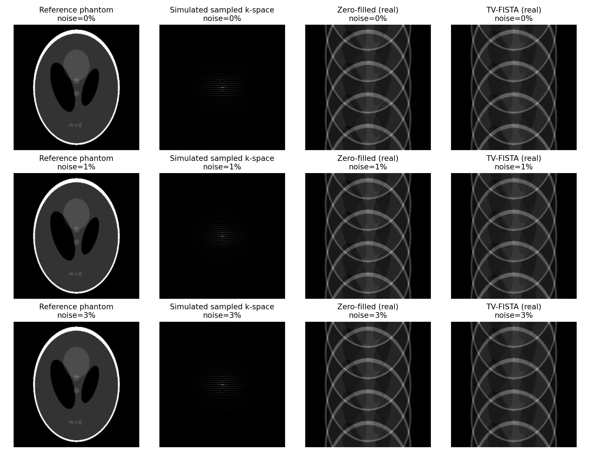
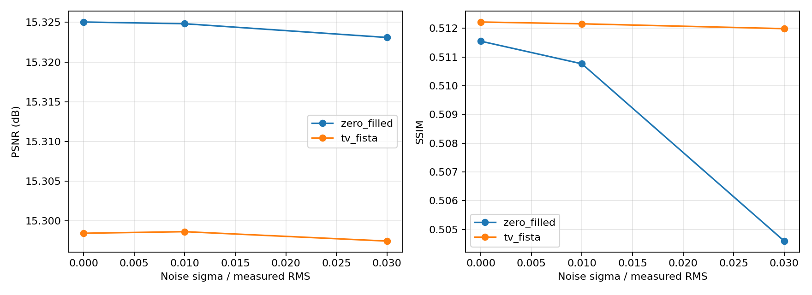

# PhysRecon-AI: Physics-Guided MRI Reconstruction from Incomplete Data
## Motivation

Reconstruct 2D images from a small subset of their Fourier-domain measurements, with a known physics-based forward operator and an interpretable total-variation prior. Evaluate recovery quality, robustness, and computational cost.

## Measured output (never predetermined)

After execution, `results/` contains:

- `metrics.csv`: per-method PSNR (dB), SSIM, runtime (seconds), measured k-space relative residual, and settings.
- `metrics.json`: experiment configuration and the measured results.
- `reconstruction_comparison.png`: simulated reference / sampled k-space / baseline / TV result.
- `noise_robustness.png`: PSNR and SSIM versus simulated k-space noise.

The validated reference run is reported below; distinguish these archived results from your locally generated results. Metrics use un-clipped real reconstructions and `data_range=1` against the normalized phantom. Runtime includes the reconstruction operation, excludes imports and figure rendering, and depends on hardware. PSNR/SSIM compare against known phantom ground truth and are *not clinically validated*.

## Validated example: local reference run

The following numbers come from an executed **synthetic phantom** experiment in the provided development environment (256×256, 4× uniform undersampling, 80 iterations, `lambda_tv=0.015`, noise=0). They are **not** benchmarks on real MRI data. Timings are hardware-dependent and should be remeasured on your computer.

| Metric | Zero-filled | TV-FISTA |
| --- | ---: | ---: |
| PSNR (dB) | 15.3250 | 15.2985 |
| SSIM | 0.51155 | 0.51222 |
| Reconstruction runtime (s) | 0.0087 | 6.27 |
| Relative measured k-space residual | ~0 | 0.02981 |

**Interpretation:** TV gives a very small SSIM increase (~0.00067), a slight PSNR decrease (~0.027 dB), and considerable additional compute time; its **soft** data-consistency penalty permits nonzero measured-frequency residual. The visible aliasing artifacts persist for both approaches. These results **do not demonstrate successful de-aliasing** or statistically established noise robustness; three noise settings on one phantom are exploratory. A periodic every-fourth-line mask leaves a highly ambiguous inverse problem. Next experiments should compare center-calibrated variable-density masks, regularization-strength sweeps, and MRI-realistic complex-valued data.

### Reproducible visualizations

*Figure 1.* Rows correspond to simulated noise settings, not distinct subjects; columns show reference, sampled Fourier measurements, zero-filled image, and TV-regularized image. Fourier-domain plots use logarithmic magnitude for visibility.

*Figure 2.* Noise sensitivity for this one phantom. TV has slightly higher SSIM and lower PSNR at all sampled noise levels. Small changes should not be read as evidence of general robustness.

The exact reference-run CSV/JSON are archived in [`docs/validation/`](docs/validation/). To recompute on your own hardware, run `python run.py` and inspect the newly generated `results/` directory. The runtime values will differ. The code uses reproducible random seeds for simulated noise, but CPU timings are not deterministic.

## Engineering trade-offs and limitations

- Higher TV regularization can suppress noise/streaks but blur edges and fine anatomical detail.
- More iterations may improve optimization but increase runtime.
- Uniform 4x sampling is reproducible but induces coherent aliasing; randomized/variable-density masks are a future ablation.
- A single simulated phantom is not evidence of generalization to clinical MRI.
- This baseline ignores coil sensitivities, complex spatial phase, motion, and realistic acquisition artifacts.
- FISTA here uses a numerical, approximately solved TV proximal step; convergence diagnostics and a fully specified discretization should be added before research-grade comparisons.
- Retrospectively masked full-data k-space is different from prospectively accelerated scanning.

