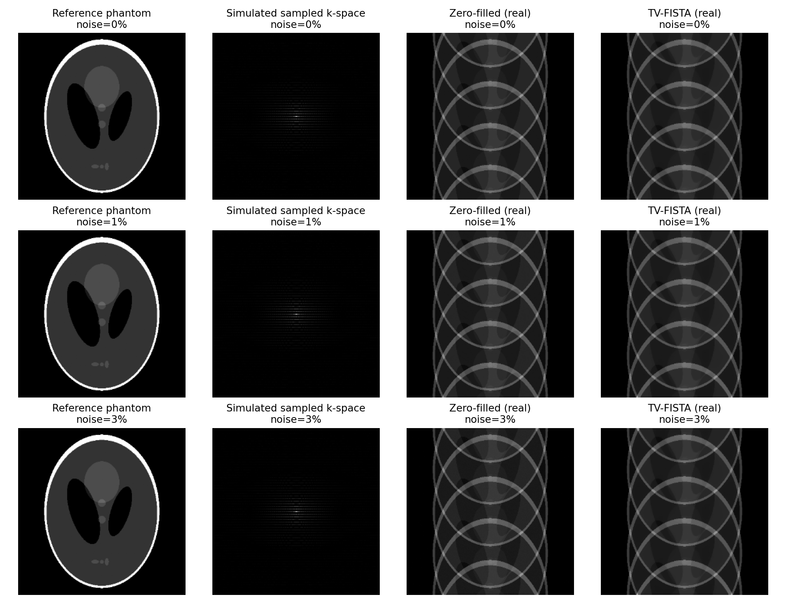
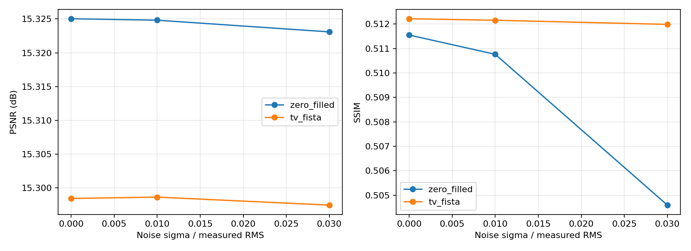

# PhysRecon-AI — Physics-Constrained MRI Inverse Reconstruction

**Independent Fall 2027 PhD portfolio proof of concept** · inverse problems · computational imaging · optimization

> **Data integrity:** The main experiment uses the synthetic Shepp–Logan phantom. Its k-space measurements are **simulated** by applying an FFT and retrospectively masking Fourier coefficients. This is **not real scanner-acquired MRI data**, and it is **not image classification**.

## Motivation

Reconstruct 2D images from a small subset of their Fourier-domain measurements, with a known physics-based forward operator and an interpretable total-variation prior. Evaluate recovery quality, robustness, and computational cost.

## Quickstart (Windows PowerShell)

```powershell
cd PhysRecon-AI
python -m venv .venv
.\.venv\Scripts\Activate.ps1
python -m pip install -r requirements.txt
python run.py
```

If PowerShell blocks venv activation, call `.\.venv\Scripts\python.exe -m pip install -r requirements.txt` and `.\.venv\Scripts\python.exe run.py` instead.

Approximate runtime depends on machine, Python environment, and iteration count. For a quicker check: `python run.py --size 128 --iterations 30` (results differ).

## Forward model and optimization

Let `x` be the real-valued reference intensity image, `F` an orthonormal centered 2D FFT, and `M` a Cartesian k-space mask. Then `y = M F x + epsilon`, with optional complex Gaussian noise only on acquired frequencies.

**Baseline:** real part of `F^-1 y` (zero-filled inverse Fourier reconstruction). For complex scanner data, a phase-aware algorithm will be necessary.

**Optimization:**

```text
argmin_{x real} 0.5 || M F x - y ||_2^2 + lambda * TV(x)
TV(x) = sum_pixels sqrt((Dx x)^2 + (Dy x)^2)   (isotropic discrete TV)
```

The solver uses proximal-gradient FISTA with an approximate TV proximal operator (`skimage.restoration.denoise_tv_chambolle`). The gradient of the data term is `Re[F^-1 M (M F x - y)]`. The orthonormal FFT and 0/1 mask imply a Lipschitz bound `L <= 1`, so step size 1 is valid. TV is a **soft prior**; fidelity is **soft data consistency**, not exact hard replacement of sampled coefficients. This is preferable to hard consistency in the presence of measurement noise.

**Sampling:** exact 4x undersampling at 256×256: every 4th phase-encoding line, no autocalibration center (ACS). This intentionally simplistic uniform periodic mask creates strong coherent aliasing; production MRI often uses ACS and different masks. For other shapes, see the `--size` guard.

**Noise levels:** 0%, 1%, and 3%. Noise is complex Gaussian on measured coefficients; noise fraction is relative to the RMS amplitude of *acquired* Fourier values, not pixel-wise image noise and not a scanner-reported SNR.

## Measured output (never predetermined)

After execution, `results/` contains:

- `metrics.csv`: per-method PSNR (dB), SSIM, runtime (seconds), measured k-space relative residual, and settings.
- `metrics.json`: experiment configuration and the measured results.
- `reconstruction_comparison.png`: simulated reference / sampled k-space / baseline / TV result.
- `noise_robustness.png`: PSNR and SSIM versus simulated k-space noise.

The validated reference run is reported below; distinguish these archived results from your locally generated results. Metrics use un-clipped real reconstructions and `data_range=1` against the normalized phantom. Runtime includes the reconstruction operation, excludes imports and figure rendering, and depends on hardware. PSNR/SSIM compare against known phantom ground truth and are *not clinically validated*.

## Validated example: local reference run

The following numbers come from an executed **synthetic phantom** experiment in the provided development environment (256×256, 4× uniform undersampling, 80 iterations, `lambda_tv=0.015`, noise=0). They are **not** benchmarks on real MRI data. Timings are hardware-dependent and should be remeasured on your computer.

| Metric | Zero-filled | TV-FISTA |
| --- | ---: | ---: |
| PSNR (dB) | 15.3250 | 15.2985 |
| SSIM | 0.51155 | 0.51222 |
| Reconstruction runtime (s) | 0.0087 | 6.27 |
| Relative measured k-space residual | ~0 | 0.02981 |

**Interpretation:** TV gives a very small SSIM increase (~0.00067), a slight PSNR decrease (~0.027 dB), and considerable additional compute time; its **soft** data-consistency penalty permits nonzero measured-frequency residual. The visible aliasing artifacts persist for both approaches. These results **do not demonstrate successful de-aliasing** or statistically established noise robustness; three noise settings on one phantom are exploratory. A periodic every-fourth-line mask leaves a highly ambiguous inverse problem. Next experiments should compare center-calibrated variable-density masks, regularization-strength sweeps, and MRI-realistic complex-valued data.

### Reproducible visualizations



*Figure 1.* Rows correspond to simulated noise settings, not distinct subjects; columns show reference, sampled Fourier measurements, zero-filled image, and TV-regularized image. Fourier-domain plots use logarithmic magnitude for visibility.



*Figure 2.* Noise sensitivity for this one phantom. TV has slightly higher SSIM and lower PSNR at all sampled noise levels. Small changes should not be read as evidence of general robustness.

The exact reference-run CSV/JSON are archived in [`docs/validation/`](docs/validation/). To recompute on your own hardware, run `python run.py` and inspect the newly generated `results/` directory. The runtime values will differ. The code uses reproducible random seeds for simulated noise, but CPU timings are not deterministic.

## Engineering trade-offs and limitations

- Higher TV regularization can suppress noise/streaks but blur edges and fine anatomical detail.
- More iterations may improve optimization but increase runtime.
- Uniform 4x sampling is reproducible but induces coherent aliasing; randomized/variable-density masks are a future ablation.
- A single simulated phantom is not evidence of generalization to clinical MRI.
- This baseline ignores coil sensitivities, complex spatial phase, motion, and realistic acquisition artifacts.
- FISTA here uses a numerical, approximately solved TV proximal step; convergence diagnostics and a fully specified discretization should be added before research-grade comparisons.
- Retrospectively masked full-data k-space is different from prospectively accelerated scanning.

## fastMRI extension (not part of the validated MVP)

The publicly described NYU fastMRI resource offers **raw k-space MRI measurements**, subject to its dataset access terms. See https://fastmri.med.nyu.edu/ and https://github.com/facebookresearch/fastMRI . Once a *singlecoil* HDF5 file is obtained, `fastmri_optional.py <file.h5>` checks its k-space representation, but **deliberately does not report metrics or pretend the real-valued phantom solver is correct for complex scanner measurements**. A defensible next step is to implement complex/phase-aware TV (or a phase-aware primal-dual solver), account for acquisition conventions and, for multicoil scans, coil sensitivities. Then measure reconstruction using retrospective masks and a clearly described reference.

## Target research discussions

Relevant themes: medical imaging and MRI inverse problems (Stanford John Pauly; MIT Polina Golland), computational inverse imaging (Stanford Gordon Wetzstein, Purdue Charles Bouman, Penn State Vishal Monga), and transferable inverse imaging concepts for materials characterization (UT Austin Yijin Liu). This is research-interest alignment, **not** an assertion of recruitment, endorsement, or direct MRI specialization for every professor.

## GitHub

```powershell
git init
git add README.md requirements.txt recon.py run.py fastmri_optional.py .gitignore
git commit -m "Initial PhysRecon-AI MRI inverse reconstruction proof of concept"
git branch -M main
# Create an empty repository named PhysRecon-AI in GitHub, then:
# git remote add origin https://github.com/YOUR_USERNAME/PhysRecon-AI.git
# git push -u origin main
```

Only commit experimental metrics and plots after you have independently run the experiment and inspected the output. Do not commit fastMRI HDF5 files or other licensed data.

## Suggested next experiments

Parameter sweep over TV weights and iteration counts; radial/variable-density masks (matching desired acquisition model); independent MRI image references; robust, phase-aware singlecoil reconstruction; multicoil forward model; comparison with wavelet regularization and learned unrolled reconstruction.
